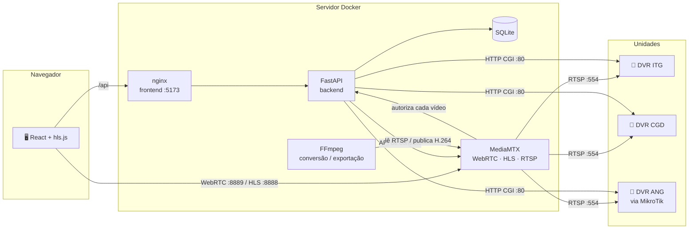
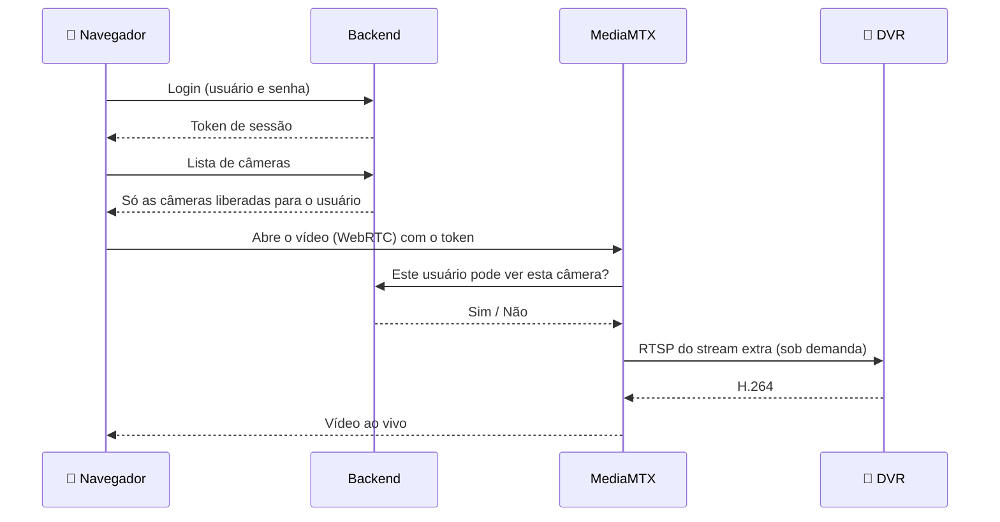
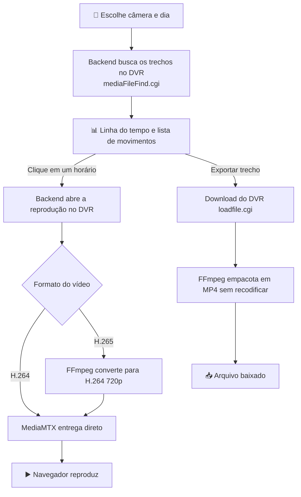
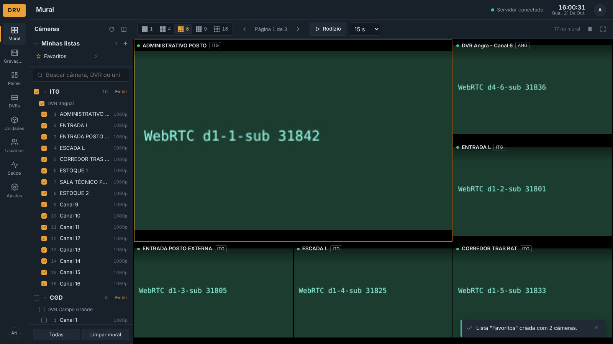
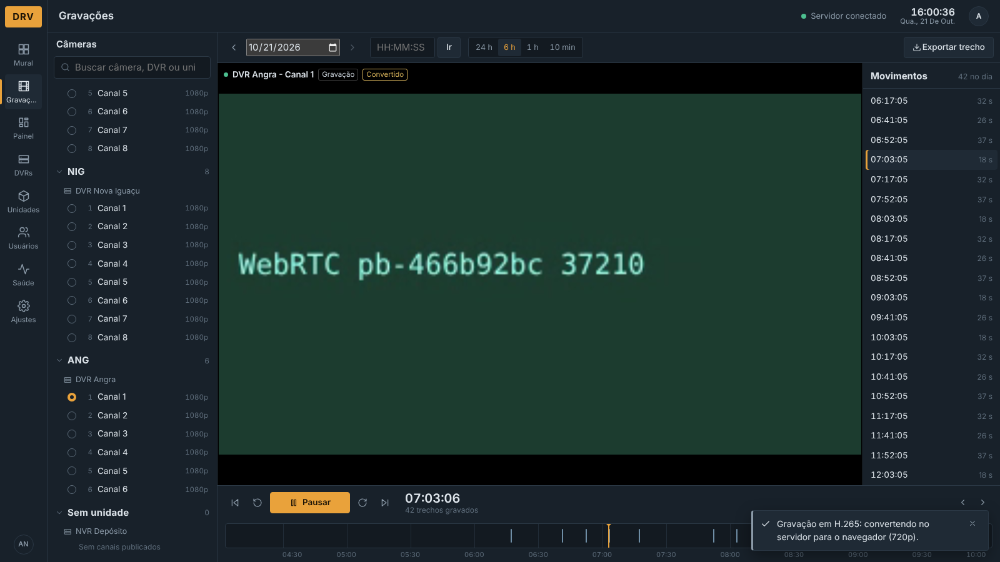
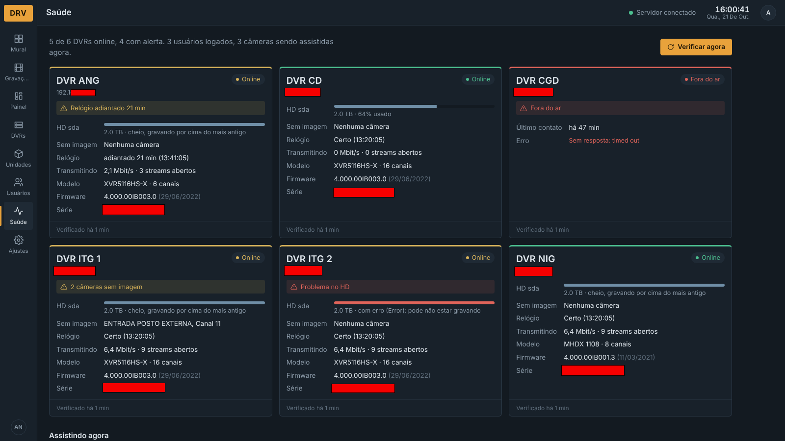
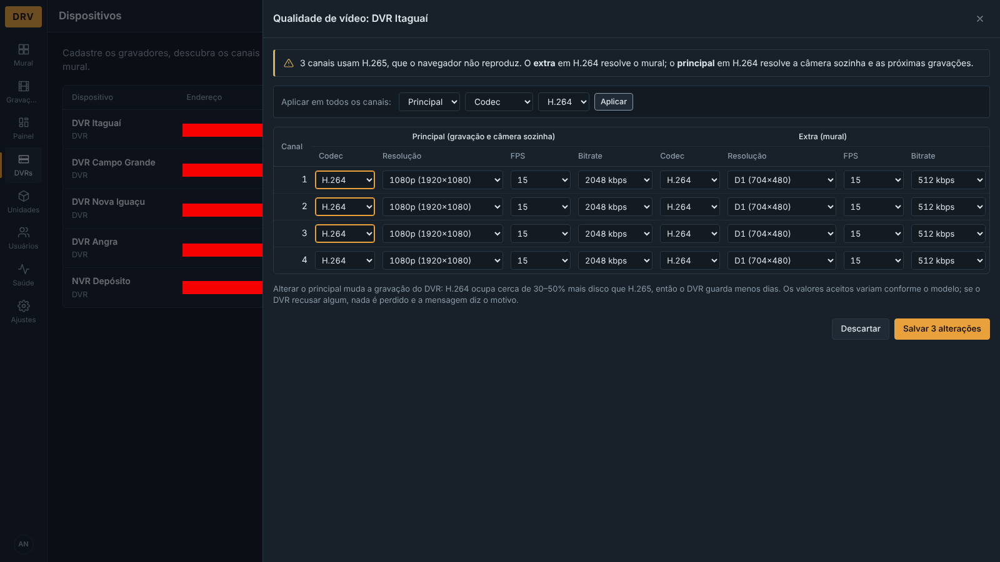
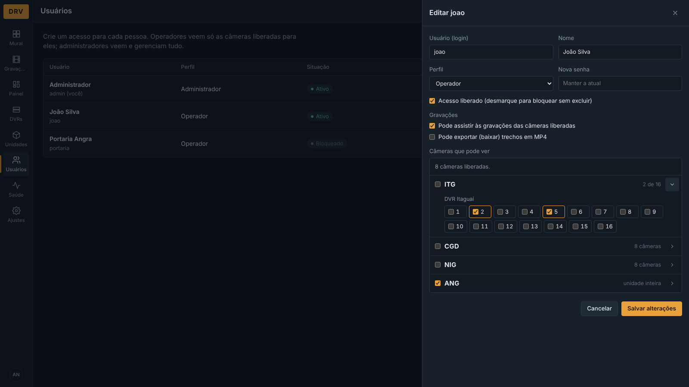
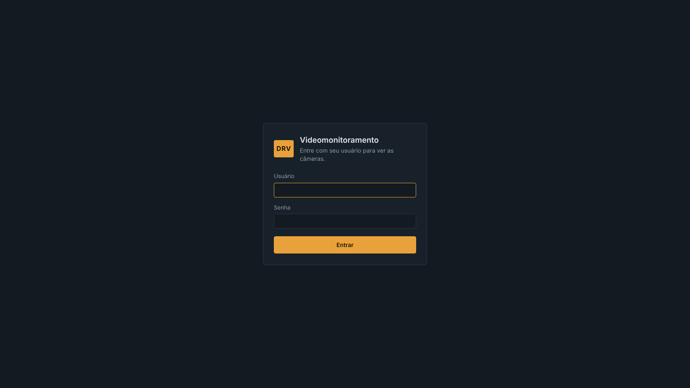

# DRV — Videomonitoramento CFTV


<p>&nbsp;</p>

<div align="center">
  
  <h3>Todos os DVRs Intelbras das unidades em um único mural, no navegador.</h3>
</div>

<p>&nbsp;</p>

### **Índice**

1. [📝 Descrição do Projeto](#-descrição-do-projeto)
2. [⚙️ Arquitetura e Tecnologias](#️-arquitetura-e-tecnologias)
3. [📁 Estrutura do Projeto](#-estrutura-do-projeto)
4. [🔄 Fluxo de Funcionamento](#-fluxo-de-funcionamento)
5. [🚀 Funcionalidades](#-funcionalidades)
6. [📡 Integração com os DVRs Intelbras](#-integração-com-os-dvrs-intelbras)
7. [💻 Como Executar](#-como-executar-o-projeto)
8. [🌐 Rede e Unidades Remotas](#-rede-e-unidades-remotas)
9. [🔒 Segurança e LGPD](#-segurança-e-lgpd)
10. [🛠️ Solução de Problemas](#️-solução-de-problemas)
11. [🧭 Próximos Passos](#-próximos-passos)
12. [👥 Equipe](#-equipe-do-projeto)
13. [✅ Conclusão](#-conclusão)
14. [📸 Prévia](#-prévia-do-projeto)

<p>&nbsp;</p>

## 📝 **Descrição do Projeto**

O **DRV** é uma aplicação web de videomonitoramento que centraliza os DVRs Intelbras de todas as unidades em uma única interface. Em vez de abrir o software de cada gravador ou o aplicativo do fabricante, a equipe acompanha as câmeras ao vivo em um mural, consulta as gravações por linha do tempo, exporta trechos em MP4 e administra usuários, permissões e qualidade de vídeo — tudo pelo navegador, de qualquer computador da rede.

O sistema conversa diretamente com os DVRs pelos protocolos que eles já oferecem (RTSP e a API HTTP do padrão Dahua/Intelbras), sem depender de nuvem ou de software proprietário. O **MediaMTX** recebe os vídeos e os entrega ao navegador por **WebRTC** (abertura em cerca de 1 segundo) ou **HLS**, e o backend em **FastAPI** cuida de autenticação, permissões, gravações e da saúde dos equipamentos.

### **Principais Diferenciais**

* ⚡ **Abertura rápida:** WebRTC com queda automática para HLS; o mural usa o stream extra e mantém a conexão com o DVR aquecida para trocar de página sem espera.
* 🎞️ **Gravações no navegador:** linha do tempo com os movimentos do dia, reprodução a partir de qualquer horário e exportação em MP4 sem recodificar.
* 🔄 **Conversão sob demanda:** gravações em H.265, que o navegador não reproduz, são convertidas no servidor para H.264 apenas quando necessário.
* 👥 **Controle de acesso:** login por usuário, perfis administrador/operador e permissão por unidade ou por câmera — inclusive nos streams de vídeo.
* 🩺 **Saúde dos DVRs:** HD, câmeras sem imagem, relógio, firmware, banda e quem está assistindo, em uma única página.
* 🎛️ **Qualidade pelo app:** codec, resolução, FPS e bitrate de cada canal alterados no DVR sem abrir a interface do equipamento.
* 🐳 **Implantação simples:** sobe e derruba tudo com um único `docker compose`.

<p>&nbsp;</p>

## ⚙️ **Arquitetura e Tecnologias**



#### **Tecnologias Utilizadas**

| Camada | Tecnologia | Função |
| :--- | :--- | :--- |
| **Frontend** | React 19 + TypeScript 6 | Interface do mural, gravações e administração |
| **Build** | Vite 8 | Build de produção e servidor de desenvolvimento |
| **Player** | WebRTC (WHEP) + hls.js | Vídeo de baixa latência com fallback automático para HLS |
| **Servidor web** | nginx | Serve o frontend e encaminha `/api` ao backend |
| **Backend** | Python 3.12 + FastAPI | API REST, autenticação, permissões e integração com os DVRs |
| **Banco de dados** | SQLite | Dispositivos, canais, usuários, permissões, listas e histórico |
| **Streaming** | MediaMTX | Converte RTSP dos DVRs em WebRTC/HLS, com autorização por requisição |
| **Vídeo** | FFmpeg | Descoberta de canais, exportação MP4 e conversão H.265 → H.264 |
| **Criptografia** | cryptography (Fernet) + scrypt | Senhas dos DVRs criptografadas; senhas de usuários com hash |
| **Infraestrutura** | Docker Compose | Três serviços: `mediamtx`, `backend` e `frontend` |

<p>&nbsp;</p>

## 📁 **Estrutura do Projeto**

```bash
cftv/
│
├── backend/                         # 🐍 API em FastAPI
│   ├── app/
│   │   ├── main.py                  # Rotas, banco, autenticação, gravações e saúde
│   │   ├── security.py              # Hash de senhas, tokens de sessão, nomes dos caminhos
│   │   ├── recordings.py            # Busca, reprodução e download de gravações no DVR
│   │   ├── encoding.py              # Leitura e alteração de codec/resolução/FPS/bitrate
│   │   └── device_info.py           # Saúde do DVR: HD, perda de vídeo, relógio, firmware
│   ├── Dockerfile                   # Python 3.12 + FFmpeg
│   └── requirements.txt
│
├── frontend/                        # ⚛️ Interface em React
│   ├── src/
│   │   ├── components/
│   │   │   ├── auth/                # Tela de login e sessão
│   │   │   ├── cameras/             # Player (WebRTC/HLS), quadro, árvore e listas
│   │   │   ├── devices/             # Formulário do DVR e painel de qualidade
│   │   │   ├── recordings/          # Linha do tempo das gravações
│   │   │   ├── layout/              # Menu lateral, barra superior, navegação
│   │   │   └── ui/                  # Ícones, avisos, painel lateral
│   │   ├── hooks/                   # Carregamento de unidades, DVRs e canais
│   │   ├── pages/                   # Mural, Gravações, Painel, DVRs, Unidades,
│   │   │                            # Usuários, Saúde e Ajustes
│   │   ├── services/                # Cliente da API e sessão
│   │   ├── styles/                  # Tema visual (sala de controle)
│   │   └── types/                   # Tipos TypeScript
│   ├── nginx.conf                   # Proxy de /api para o backend
│   └── Dockerfile                   # Build Node 22 + nginx
│
├── mediamtx/
│   └── mediamtx.yml                 # API, WebRTC e autenticação via backend
│
├── docs/img/                        # Capturas de tela do README
├── data/                            # Banco SQLite (fora do Git)
├── .env.example                     # Modelo das variáveis de ambiente
└── docker-compose.yml               # Sobe os três serviços
```

<p>&nbsp;</p>

## 🔄 **Fluxo de Funcionamento**

### **Ao vivo**



### **Gravações**



### **Detalhamento**

1. **Autenticação:** o usuário entra com login e senha; a sessão dura 24 h e se renova com o uso.
2. **Permissões:** o backend filtra DVRs, unidades e câmeras; o MediaMTX consulta o backend antes de liberar **cada** vídeo, então não há como abrir um stream pela URL sem permissão.
3. **Ao vivo:** o mural usa o stream extra do DVR; ver uma câmera sozinha usa o principal e, se ele não tocar, cai para o extra.
4. **Gravações:** a busca é feita no próprio DVR; o servidor identifica o formato e converte apenas o que o navegador não reproduz.
5. **Monitoramento:** a cada 2 minutos o backend verifica cada DVR e sincroniza os nomes dos canais.

<p>&nbsp;</p>

## 🚀 **Funcionalidades**

### **1. 📺 Mural**
- Divisões de 1, 4, 6 (uma grande e cinco pequenas), 9 e 16 câmeras, com páginas
- Rodízio automático com tempo configurável e barra de progresso
- Arrastar câmeras entre posições, duplo clique para ver sozinha, tela cheia
- Marcar/desmarcar todas as câmeras de uma unidade ou de um DVR com um clique
- **Minhas listas:** listas pessoais de câmeras (ex.: "Favoritos") salvas no servidor
- Reconexão automática, detecção de imagem congelada e aviso de formato não suportado
- Atalhos: `←` `→` páginas · `Espaço` rodízio · `F` tela cheia · `Esc` voltar

### **2. 🎞️ Gravações**
- Linha do tempo de 24 h com zoom (6 h, 1 h e 10 min) e os trechos com movimento
- Lista de movimentos do dia, ir para horário, ±30 s e movimento anterior/próximo
- Horário sem gravação pula para o próximo trecho gravado
- **Exportação em MP4** de até 2 h, baixada sem sair do app
- **Conversão H.265 → H.264** automática e botão "Tentar convertendo"

### **3. 📼 Dispositivos e Unidades**
- Cadastro de DVRs por IP (senha guardada criptografada)
- Testar conexão, descobrir canais com vídeo e ativar o streaming
- Organização dos DVRs por unidade (ITG, CGD, ANG...)
- **Qualidade:** codec, resolução, FPS e bitrate do principal e do extra, por canal ou em todos

### **4. 👥 Usuários e Permissões**
- Perfis **Administrador** (gerencia tudo) e **Operador** (só o que foi liberado)
- Permissão por unidade inteira (inclui câmeras adicionadas depois) e/ou por câmera
- Opções por operador: pode assistir gravações / pode exportar
- Bloqueio de usuário e troca de senha derrubam as sessões abertas

### **5. 🩺 Saúde (administrador)**
- Online/fora do ar, HD (uso e erro), câmeras sem imagem e relógio do DVR
- Modelo, firmware e número de série
- Banda que cada DVR está enviando e quem está assistindo cada câmera agora
- Histórico: logins, senhas erradas, gravações assistidas, exportações e alterações

<p>&nbsp;</p>

## 📡 **Integração com os DVRs Intelbras**

O sistema usa apenas interfaces nativas dos DVRs Intelbras (padrão Dahua). Testado com o **XVR5116HS-X**; outros modelos Intelbras com a mesma API devem funcionar.

| Recurso | Interface no DVR | Uso no sistema |
| :--- | :--- | :--- |
| Ao vivo | `rtsp://…/cam/realmonitor?channel=N&subtype=0/1` | Stream principal (0) e extra (1) |
| Reprodução | `rtsp://…/cam/playback?channel=N&starttime=…&endtime=…` | Assistir gravações |
| Busca de gravações | `/cgi-bin/mediaFileFind.cgi` | Linha do tempo e movimentos |
| Exportação | `/cgi-bin/loadfile.cgi?action=startLoad` | Download do trecho (.dav → MP4) |
| Qualidade | `/cgi-bin/configManager.cgi?name=Encode` | Ler e alterar codec/resolução/FPS/bitrate |
| Nomes dos canais | `/cgi-bin/configManager.cgi?name=ChannelTitle` | Nome de cada câmera |
| Sistema | `/cgi-bin/magicBox.cgi` | Modelo, série e firmware |
| HDs | `/cgi-bin/storageDevice.cgi` | Capacidade, uso e estado |
| Perda de vídeo | `/cgi-bin/eventManager.cgi?code=VideoLoss` | Câmeras sem imagem |
| Relógio | `/cgi-bin/global.cgi?action=getCurrentTime` | Diferença de horário |

### **Requisitos no DVR**
- **RTSP** habilitado (porta 554) e **HTTP** (porta 80) acessíveis pelo servidor
- Um usuário para o sistema com permissão de **visualização** e **reprodução**; para alterar a qualidade pelo app, também **configuração**
- **Stream extra em H.264** (recomendado): o mural abre por WebRTC sem depender do decodificador da placa de vídeo
- Stream principal em **H.264** dispensa a conversão nas novas gravações; em H.265 ocupa menos disco e a conversão entra só ao assistir

<p>&nbsp;</p>

## 💻 **Como Executar o Projeto**

### **Pré-requisitos**
* **Docker** e **Docker Compose** (plugin `docker compose`)
* **Git**
* Rede do servidor alcançando os DVRs (RTSP 554 e HTTP 80)

### **Instalação**

```bash
# 1. Clone o repositório
git clone https://github.com/amaro-netto/cftv.git
cd cftv

# 2. Crie o .env a partir do modelo
cp .env.example .env

# 3. Gere a chave que criptografa as senhas dos DVRs e cole em CREDENTIALS_KEY
python3 -c "from cryptography.fernet import Fernet; print(Fernet.generate_key().decode())"
nano .env

# 4. Suba tudo
docker compose up -d --build

# 5. Veja a senha do usuário admin criado na primeira subida
docker compose logs backend | grep -A1 "Usuário inicial"

# 6. Acesse no navegador
# http://IP-DO-SERVIDOR:5173
```

Depois do primeiro acesso: **DVRs → Novo dispositivo**, **Descobrir canais** e **Ativar streaming**. Os canais são republicados automaticamente a cada subida do backend.

### **Comandos do Dia a Dia**

| Comando | Descrição |
| :--- | :--- |
| `docker compose up -d` | Sobe todos os serviços |
| `docker compose down` | Derruba todos os serviços |
| `docker compose up -d --build` | Aplica alterações de código |
| `docker compose ps` | Situação dos containers |
| `docker compose logs -f backend` | Acompanha os logs do backend |
| `git merge --no-edit origin/<branch>` | Junta uma atualização sem pedir mensagem |

### **Variáveis de Ambiente (`.env`)**

| Variável | Obrigatória | Descrição |
| :--- | :---: | :--- |
| `CREDENTIALS_KEY` | ✅ | Chave Fernet que criptografa as senhas dos DVRs |
| `MTX_API_USER` / `MTX_API_PASSWORD` | ✅ | Credenciais internas da API do MediaMTX |
| `MTX_HLS_BASE_URL` | ✅ | Endereço do servidor visto pelos navegadores (porta 8888) |
| `MTX_WEBRTC_BASE_URL` | — | Padrão: mesmo host na porta 8889 |
| `CFTV_ADMIN_PASSWORD` | — | Senha do `admin` criado na primeira subida |
| `MTX_CLOSE_AFTER` | — | Tempo que o DVR fica conectado sem ninguém assistindo (padrão `60s`) |
| `HEALTH_INTERVAL` | — | Segundos entre verificações de saúde (padrão `120`) |
| `MAX_TRANSCODES` | — | Conversões H.265 simultâneas (padrão `2`) |
| `TRANSCODE_HEIGHT` | — | Altura do vídeo convertido (padrão `720`) |
| `TZ` | — | Fuso dos DVRs (padrão `America/Sao_Paulo`) |

### **Portas**

| Porta | Serviço | Uso |
| :--- | :--- | :--- |
| `5173` | frontend | Aplicação no navegador |
| `8889` / `8189/udp` | MediaMTX | WebRTC |
| `8888` | MediaMTX | HLS |
| `8554` | MediaMTX | RTSP |
| `127.0.0.1:9997` | MediaMTX | API de controle (só local) |

<p>&nbsp;</p>

## 🌐 **Rede e Unidades Remotas**

O servidor precisa alcançar cada DVR pela rede (VPN ou rotas entre unidades). Quando a volta do tráfego não passa pelo mesmo caminho — por exemplo, um DVR atrás de um roteador que só aceita respostas originadas nele — basta publicar as portas do DVR no IP do roteador da unidade. Exemplo em **MikroTik**:

```bash
/ip firewall nat add chain=dstnat in-interface=wireguard-oracle dst-address=xxx.xxx.xxx.xxx \
    protocol=tcp dst-port=80,554,37777 action=dst-nat to-addresses=xxx.xxx.xxx.x \
    comment="CFTV -> DVR" place-before=0
```

No sistema, o DVR é cadastrado com o IP do roteador (`192.168.1.254`), e a interface web do DVR também fica acessível por ele.

<p>&nbsp;</p>

## 🔒 **Segurança e LGPD**

Imagens de câmeras identificam pessoas e são **dados pessoais** (Lei 13.709/2018). O sistema foi construído para limitar e registrar o acesso a elas:

| Aspecto | Implementação |
| :--- | :--- |
| **Acesso** | Login obrigatório; sessões com expiração; usuários bloqueáveis |
| **Necessidade** | Cada operador vê só as câmeras liberadas; gravações e exportação são permissões separadas |
| **Vídeo** | O MediaMTX autoriza cada stream no backend — URL de vídeo sem token não abre |
| **Rastreabilidade** | Histórico de logins, gravações assistidas, exportações e alterações |
| **Credenciais** | Senhas dos DVRs criptografadas (Fernet); senhas de usuários com hash scrypt |
| **Armazenamento** | As gravações continuam apenas nos DVRs; o servidor não guarda vídeo |
| **Rede** | API do MediaMTX publicada só em `127.0.0.1`; banco e `.env` fora do Git |

<p>&nbsp;</p>

## 🛠️ **Solução de Problemas**

| Sintoma | Causa provável | O que fazer |
| :--- | :--- | :--- |
| Câmera com etiqueta **Extra** ou "Formato não suportado" | Stream principal em H.265 | DVRs → **Qualidade** → principal em H.264 |
| Mural lento ou câmeras caindo em um DVR | Stream extra em H.265 | DVRs → **Qualidade** → extra em H.264 |
| Gravação com etiqueta **Convertido** | Gravação em H.265 convertida no servidor | Normal; para evitar, use H.264 no principal |
| "Conversões ocupadas" | Limite `MAX_TRANSCODES` atingido | Aguarde ou aumente o limite no `.env` |
| DVR **Fora do ar** na Saúde | Rede, VPN ou senha do DVR | Teste com `nc -zv IP 554` a partir do servidor |
| Esqueci a senha do admin | — | Comando abaixo |

```bash
# Redefine a senha do usuário admin
docker compose exec backend python -c "import sqlite3;from app.security import hash_password as h;db=sqlite3.connect('/srv/data/devices.db');db.execute(\"UPDATE users SET password_hash=?, active=1 WHERE username='admin'\",(h('NovaSenha123'),));db.commit();print('ok')"
```

<p>&nbsp;</p>

## 🧭 **Próximos Passos**

- [ ] Reprodução de gravações em velocidade 2x/4x
- [ ] Exportação com conversão para H.264 (arquivo que abre em qualquer player)
- [ ] Alertas da página Saúde por e-mail ou Telegram (DVR fora do ar, HD com erro, câmera sem imagem)
- [ ] Integração com Intelbras Cloud para unidades sem acesso por IP
- [ ] HTTPS com certificado interno

<p>&nbsp;</p>

## 👥 **Equipe do Projeto**

<a href="https://github.com/amaro-netto" title="Amaro Netto">
  
</a>

<p>&nbsp;</p>

## ✅ **Conclusão**

O **DRV** nasceu da necessidade de acompanhar as câmeras de várias unidades sem depender do software de cada gravador nem de serviços em nuvem. Os maiores desafios foram técnicos e muito concretos: fazer vídeo de DVR abrir rápido no navegador, alcançar unidades atrás de links e roteadores diferentes, e lidar com o **H.265**, que os DVRs adotam para economizar disco mas os navegadores não reproduzem.

A solução combinou **WebRTC com fallback para HLS**, uso inteligente dos streams **principal e extra**, **conversão sob demanda** apenas quando necessária e **autorização de cada vídeo no backend**. O resultado é uma ferramenta leve, que roda em um único servidor com Docker, respeita quem pode ver o quê e dá ao time de TI visibilidade sobre a saúde dos equipamentos.

> [!IMPORTANT]
> **Uso interno**: as imagens de videomonitoramento são dados pessoais. O acesso deve ser concedido somente a quem precisa, e o histórico de acessos e exportações deve ser revisado periodicamente pelo administrador.

<p>&nbsp;</p>

## 📸 **Prévia do Projeto**

> As capturas abaixo usam dados de exemplo.

| Mural com listas e seleção por unidade | Gravações com linha do tempo |
| :---: | :---: |
|  |  |
| **Saúde dos DVRs** | **Qualidade de vídeo pelo app** |
|  |  |
| **Usuários e permissões por câmera** | **Login** |
|  |  |

---

<div align="center">
  <strong>© 2026 DRV Videomonitoramento</strong> - Desenvolvido por <em>Amaro Netto</em>.
</div>
